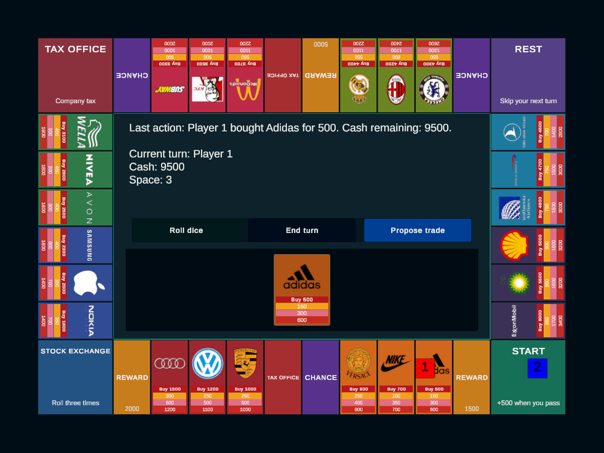

# Monopolist

**Unity and C# portfolio project by Oleksii Miroshnichenko**

Monopolist is a digital economic board game. Players buy companies, collect rent, draw Chance cards, and trade cash or assets. The last player still in the game wins.

[Watch the 14-second gameplay demo](Monopolist-gameplay.mp4) · [See a trade offer](screenshots/trade.png) · [See the main menu](screenshots/menu.png)

## Play the macOS demo

[Download the macOS build](https://github.com/mirosole/monopolist-portfolio/releases/latest/download/Monopolist-macOS.zip) and extract the archive.

Open **Monopolist.app** and select **Local game**. Two players take turns on the same computer. Roll the dice, buy or pass on the company if one is offered, then end your turn. Local play does not require an internet connection. The game, board, and Chance cards are in English.

The build includes Apple silicon and Intel executables and was tested on Apple silicon. It is a locally signed prototype without Apple notarization.

## Implementation

- **Game rules in C#** cover turn order, ownership, rent, mortgage, bankruptcy, and trades involving multiple assets.
- **Unity UI** shows the 36-space board, animated tokens, company portfolios, and trade and endgame panels.
- **JSON configuration** defines the board and Chance cards independently of the scene.
- **Private online rooms** use Unity Multiplayer Services and Relay. The host validates actions, rolls dice, and shares game state with clients.
- **Validation** includes 13 passing EditMode tests and a two-client smoke test of joining a room, taking turns, buying a company, and completing a trade.

Online play depends on Unity Services availability. Rejoining an interrupted match is experimental.
